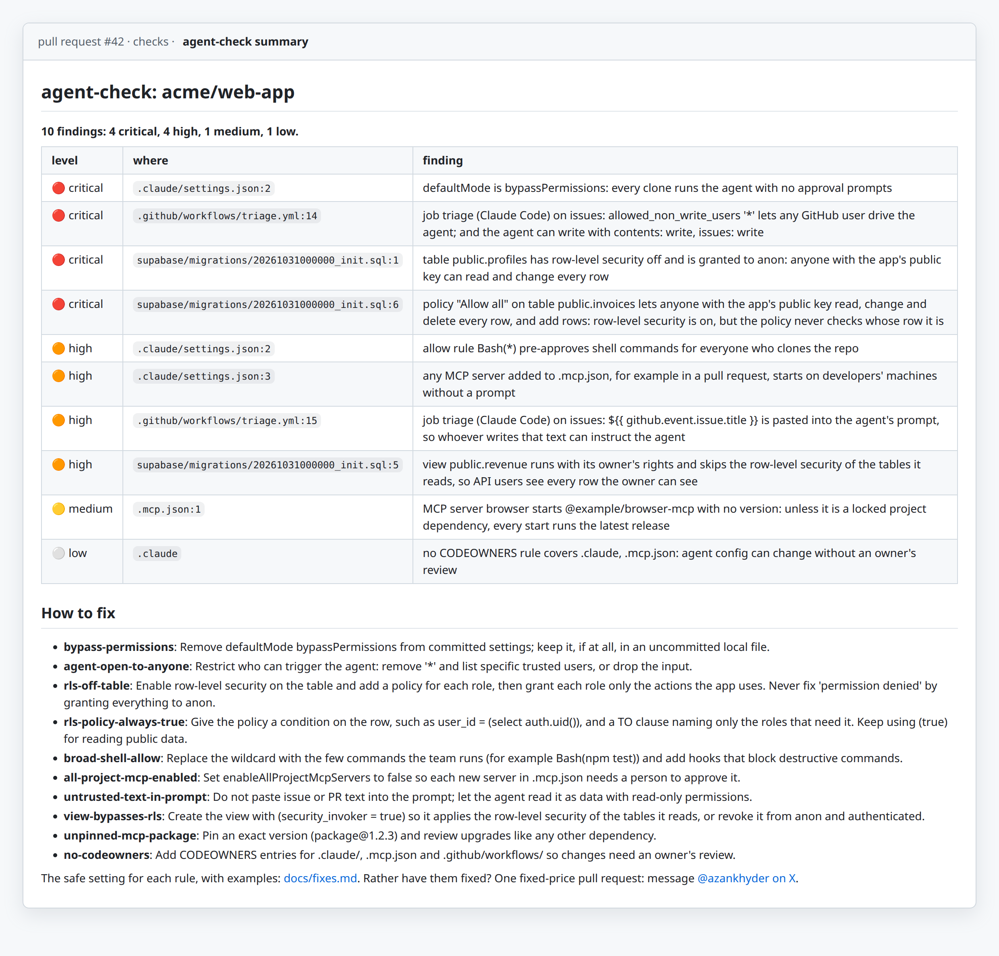

# agent-check

**What can your AI agents reach, and who can tell them what to do?** agent-check reads a repository and flags the agent setup it ships to everyone who clones it, the CI agents that a stranger's issue or comment can steer, and the Supabase tables its migrations leave open to the API. It runs on every pull request, only reads, and never prints a secret.

[](https://github.com/azank1/agent-exposure/releases) [](https://github.com/azank1/agent-exposure/actions/workflows/test.yml) [](LICENSE)



<sub>The job summary on a pull request, from a demo repository with planted mistakes.</sub>

## Add it to a repository

```yaml
# .github/workflows/agent-check.yml
on: [pull_request]
permissions:
  contents: read
jobs:
  agent-check:
    runs-on: ubuntu-latest
    steps:
      - uses: actions/checkout@v4
      - uses: azank1/agent-exposure@v1
        with:
          fail-on: high   # low | medium | high | critical | none
```

Findings show up as annotations on the pull request and as the table above in the job summary, and the job fails at or above `fail-on`. On your own machine:

```
python3 repo_check.py ~/my-repo            # markdown report, exit 1 on high or critical
python3 repo_check.py ~/my-repo --json
```

## What it catches

| where | what | worst grade |
|---|---|---|
| Claude Code settings committed to the repo | `bypassPermissions`, `Bash(*)` allow rules, the dangerous-mode prompt switched off, `enableAllProjectMcpServers`, a committed `settings.local.json` | critical |
| MCP configs for Claude Code, Cursor, VS Code, Gemini CLI and Codex | unpinned `npx`/`uvx` packages, credentials written into the file | high |
| AI agents in CI: the Claude Code, Codex and Gemini CLI actions, and agent CLIs started from `run:` | anyone can trigger the agent, sandbox or approvals off, issue or PR text pasted into the prompt, write tokens on events that carry outside text | critical |
| Workflows | pull request code checked out in a job that holds the base repository's token, `${{ }}` text pasted into `run:` | critical |
| Supabase migrations | tables with row-level security off, policies that never check whose row it is, default grants to `anon`, views without `security_invoker` | critical |

Severity follows what an outsider could actually do: pull request code that is checked out but never run, or a job limited to trusted authors, grades lower. A workflow that does not parse is reported, not skipped. For full GitHub Actions linting, run [zizmor](https://github.com/zizmorcore/zizmor) too; agent-check covers the agent layer.

<details>
<summary>Every rule in detail</summary>

- **committed Claude Code settings** that apply to every clone: `bypassPermissions`, `Bash(*)`-style allow rules, the dangerous-mode prompt switched off, `enableAllProjectMcpServers` (any server added to `.mcp.json` in a pull request starts without a prompt), a committed `settings.local.json`;
- **MCP configs** (`.mcp.json`, `.cursor/mcp.json`, `.vscode/mcp.json`, `.gemini/settings.json`, `.codex/config.toml`): unpinned `npx`/`uvx` packages, and credentials written into the file instead of referenced as `${VAR}`;
- **agent workflows** (`anthropics/claude-code-action`, `openai/codex-action`, `google-github-actions/run-gemini-cli`): anyone allowed to trigger the agent (`'*'`), sandbox or approval checks turned off, unrestricted shell tools, issue or PR text pasted into the prompt, write permissions on events that carry outside text, no `permissions:` block. An agent step given an empty `GITHUB_TOKEN` is not charged with the job's write scopes, unless `actions/checkout` left credentials in `.git/config`;
- **agent CLIs started from `run:` steps** (`claude -p`, `codex exec`, `gemini`, `aider` and others) on events that carry outside text, graded higher when approvals are skipped (`--yolo`, `--dangerously-skip-permissions`);
- **the two classic workflow holes** on the same channel: checking out pull request code in a job that holds the base repository's token (`pull_request_target`, or a comment trigger such as `issue_comment`, including `gh pr checkout`), and `${{ github.event.issue.title }}`-style text inside `run:`;
- **Supabase migrations** (`supabase/migrations/*.sql`, `supabase/schemas/*.sql`), often written by an AI app builder: tables in an exposed schema with row-level security off (critical when the migrations let `anon` change them), policies whose condition is always true or only checks that the user is signed in (critical when anyone can change or delete every row), default privileges that grant every new table to `anon`, and views that skip row-level security because they lack `security_invoker`. The migrations are replayed in order, so a later `enable row level security`, rename, revoke or `drop policy` counts, and so does a `DO` block or an event trigger that switches row-level security on or creates a policy.

</details>

### Supabase since 30 October 2026

Supabase no longer exposes a new table to the API until it is granted, and its `permission denied for table` error suggests granting the table to the role that asked, often `anon`. On a table with row-level security off, an AI builder that follows that hint opens every row to anyone holding the app's public key. agent-check replays your migrations in order and flags exactly that, along with default grants that expose every future table and views that skip row-level security. The fixes, tested on Supabase's Postgres 17: [`docs/fixes.md`](docs/fixes.md#supabase-migrations).

## Fix what it finds

Every rule has its safe setting, with examples, in [`docs/fixes.md`](docs/fixes.md). Rather have it done? I fix a repository's findings in one fixed-price pull request ($490, within two working days), or keep up to 10 repositories watched with a weekly run, a manual review and fix PRs for anything new (agent-check Watch, $490 a month). I also review agent and CI exposure for teams and set up Claude Code with guardrails that fail closed. For any of it, message me on X: [@azankhyder](https://x.com/azankhyder).

## agent-exposure: what one developer machine exposes

This repository also holds `agent_exposure.py`, a read-only check for a single machine. It lists:

- **agents and configs:** Claude Code (user and project settings, plugins), MCP servers (`~/.claude.json`, `.mcp.json`, Cursor, Windsurf, Gemini CLI, Codex), Continue, Aider;
- **risky settings:** `bypassPermissions`, broad shell allow rules, Codex `danger-full-access` / `approval_policy = never`, settings files with no hooks;
- **MCP servers** started from an unpinned package (every start runs the latest release), or with secret-named env vars or credential headers in plain config;
- **credential and wallet stores** an agent running shell commands as this user can read: cloud CLIs, GitHub/npm/PyPI tokens, SSH keys, Solana/Ethereum/Foundry/Bitcoin wallets, browser profiles, `.env` files.

It reports presence only. Nothing leaves the machine.

```
python3 agent_exposure.py --project ~/my-repo          # markdown report
python3 agent_exposure.py --project ~/my-repo --json   # machine-readable
```

## Tests

```
python3 test_agent_exposure.py    # Python 3.11+
python3 test_repo_check.py        # Python 3.10+, needs PyYAML for the workflow checks
```

The machine check is stdlib only, and the repo check needs PyYAML for workflows (the Action installs it). Neither ever prints a secret value, and there are tests for that. MIT licensed.
